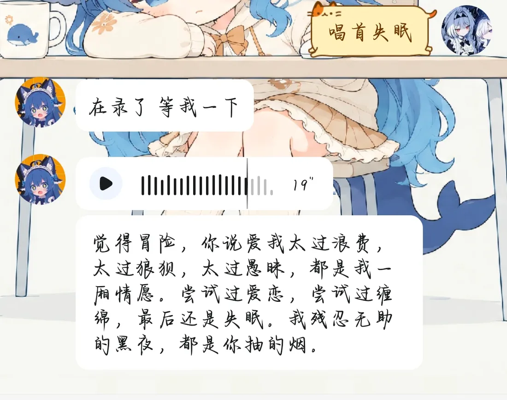
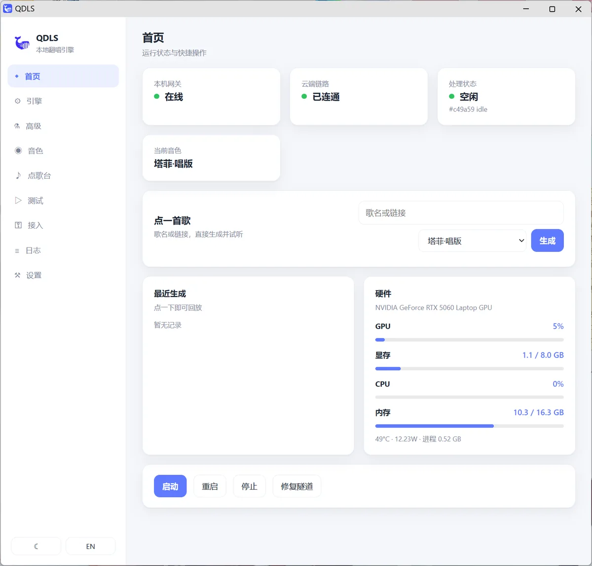
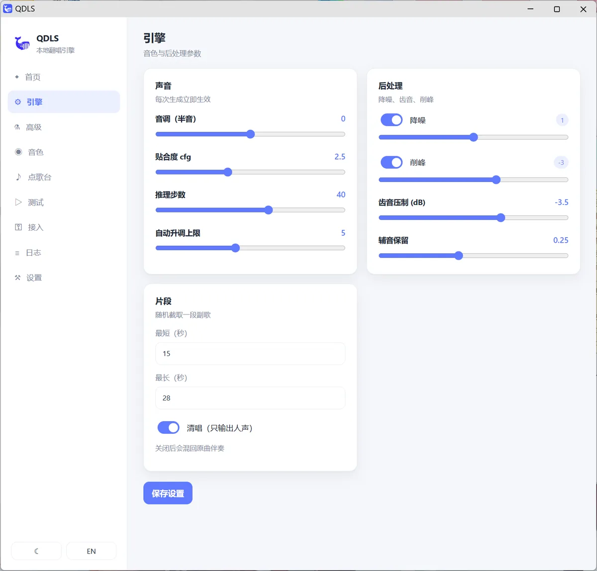

# QDLS · 本地 AI 翻唱引擎

[](https://github.com/qidianling/QDLS/releases)
[](LICENSE)
[](requirements.txt)
[](docs/amd-wsl-rocm.md)

> **一句话：在 QQ 里说「唱首失眠」，十几秒后收到一条自己的音色唱的语音。**
> 全部推理跑在你自己的显卡上——不上传音频、不排队、不依赖任何人的服务器。

<p align="center">
  
</p>

<p align="center"><i>QQ 里说一句歌名，语音和歌词直接回来（19 秒清唱片段）</i></p>

<table>
<tr>
<td width="50%"></td>
<td width="50%"></td>
</tr>
<tr>
<td align="center"><i>控制台首页：链路状态、点歌、显存/温度</i></td>
<td align="center"><i>引擎页：音调、贴合度、降噪、削峰、片段长度</i></td>
</tr>
</table>

**默认音色是 `taffy`（原创占位音色，避免任何版权问题）。** 想换成别的声音，请用你自己拥有权利的参考音频。

---

## 30 秒上手

```powershell
git clone https://github.com/qidianling/QDLS.git QDLS
cd QDLS
# 双击 setup.vbs（自动装 Python 运行时、依赖与模型，约 5.5 GB）
```

装完双击桌面 **QDLS** → 控制台「接入」页 → **写入 DSH 凭据** / 生成 AstrBot token → 装上插件即可。

> 详细步骤见 [docs/fresh-machine.md](docs/fresh-machine.md)（全新电脑）与 [docs/dsh-install.md](docs/dsh-install.md)（DSH）。

---

## ⛔ 禁止商用声明

本项目**仅限个人学习、研究与非商业用途**。

- **禁止**将本项目（含代码、模型权重、生成的音频）用于任何商业用途，包括但不限于：付费点歌、直播打赏变现、付费音乐制作、SaaS 服务、二次销售。
- **禁止**用本项目克隆、模仿、传播任何你**未获得授权**的真实歌手、声优、VTuber 的声音。
- 生成音频的版权与法律责任由使用者自负；作者不对任何滥用行为负责。
- 本项目依赖的第三方组件（SoulX-Singer 模型、Demucs、PyTorch 等）各自遵循其原始许可证，使用前请自行确认。

如果你要商用，请自行获得模型与音色权利方的书面授权。

---

## 想系统搞懂原理？

[docs/learn.md](docs/learn.md) 是写给零基础的完整教程：链接架构、每个参数的样本值、
四套优化模式、以及「质量 / 速度 / 显存」三者怎么取舍。

## 1. 这是什么 / 用途

QDLS 是一个「**本地翻唱工作站**」：

| 能力 | 说明 |
| --- | --- |
| 一键翻唱 | 给歌名或链接，自动下载 → 分离人声 → 提取音高 → 零样本音色转换 → 后处理 → 输出 mp3 |
| 音色自选 | 内置 `taffy` 占位音色；支持上传任意参考音频生成新音色（**唱声版**效果最好） |
| 只留人声 | 默认清唱输出（去伴奏）；需要伴奏可关掉清唱开关 |
| QQ 集成 | 通过 AstrBot 插件，让机器人在群里「点歌 → 翻唱 → 发语音」 |
| 远程部署 | 可把 GPU 放在家里，云端 AstrBot 通过 SSH 反向隧道调用（可选） |
| 完整控制台 | 单窗口桌面化界面：硬件监控、参数调节、音色管理、测试播放、日志 |

适用场景：个人娱乐、群机器人玩法、翻唱二创实验、学习歌声转换（SVC）原理。

---


> **AMD 显卡**：需要 WSL2 + ROCm，详见 [docs/amd-wsl-rocm.md](docs/amd-wsl-rocm.md)。
> 安装向导检测到 AMD 卡时会禁用 CUDA 安装并给出该指引（ZLUDA 不推荐，见文档末节）。


> 关闭窗口只是收进系统托盘，程序继续在后台跑；要彻底退出请右键托盘图标 → 「退出 QDLS」。

## 2. 运行环境（会自动处理）

| 依赖 | 处理方式 |
| --- | --- |
| Python 3.10 / 3.11 (64-bit) | 安装向导会**自动检测**：注册表、PATH、py 启动器、常见安装目录；**一个都没有时自动下载内置运行时**（python-3.11 embeddable + pip，约 11 MB） |
| NVIDIA 驱动 / CUDA | 自动读取 
vidia-smi 的驱动版本，**按驱动挑选 torch 轮子**：≥570 → cu128，≥528 → cu121，≥452 → cu118 |
| 显存 | 自动读显存：< 8 GB 自动开启 FP16，< 6.5 GB 自动把片段上限降到 20 秒 |
| 安装位置 | 可浏览选择，显示可用空间；< 12 GB 会提示 |
| 模型与源码 | ModelScope（国内可达）下载，带百分比进度；GitHub 拉不到时自动改用 zip |

安装向导第一步就是「环境自检」，显卡、驱动、显存、Python、磁盘都会列出来，不合格会直接给出中文原因，不会装到一半才失败。

## 2. 硬件要求

| | 最低配置 | 推荐配置 |
| --- | --- | --- |
| GPU | NVIDIA GTX 1660 6GB（CUDA 11.8+） | RTX 3060 12GB / 4060 8GB 及以上 |
| 显存 | 6 GB | 8 GB+（fp16 模式可降到 ~4 GB） |
| 内存 | 16 GB | 32 GB |
| CPU | 4 核 | 6 核以上 |
| 磁盘 | 12 GB 可用 | 20 GB（含缓存与输出） |
| 系统 | Windows 10 21H2+ / 11 64 位 | 同左 |
| 网络 | 能访问网易云/QQ 音乐与 ModelScope | 同左 |

> **没有 NVIDIA 显卡就不要装**：CPU 推理一首歌需要 20~40 分钟，且极易内存溢出。

实测参考：RTX 5060 Laptop 8GB —— 30 秒片段约 **45~70 秒**出片（含分离与后处理）。

---

## 3. 快速开始

### 3.1 安装（图形安装向导）

下载发布包并解压到一个临时目录，双击 **`setup.vbs`**：

```
QDLS-Setup/
├─ setup.vbs          ← 双击它
├─ setup.py
├─ setup_ui.html
└─ …（程序与示例音色）
```

浏览器会打开**安装向导**（`http://127.0.0.1:6790`）：

| 步骤 | 你能做什么 |
| --- | --- |
| 1 位置 | 选择安装目录（可点「浏览…」用系统对话框挑），实时显示**路径预览**、可用空间、是否可写 |
| 2 组件 | 勾选要装的内容：Python 依赖 / SVC 模型 / Demucs 权重 / 卡拉 OK 模型（各带体积）；已装过依赖或已有 SoulX-Singer 目录可以直接填路径复用 |
| 3 下载 | 真实下载进度：当前文件、已下载/总大小、百分比、实时日志；不再只是“解压 zip” |
| 4 完成 | 自动写入 `settings.json`、在桌面创建**唯一**的 `QDLS` 快捷方式 |

### 3.2 命令行安装（可选）

```powershell
git clone <this-repo> QDLS
cd QDLS
powershell -ExecutionPolicy Bypass -File install.ps1
```

模型也可以手动下载：<https://modelscope.cn/models/Soul-AILab/SoulX-Singer-SVC>，放进 `pretrained/`。

### 3.4 界面细节

- 处理中：浮窗显示**已用时间 + 预计剩余时间**（历史时长与阶段进度加权，跑得越多越准），状态卡也有同样的计时；伴随旋转圆环与进度条。
- 处理中（旧）：状态卡出现**旋转圆环**，点歌时还会弹出居中的加载浮层，实时显示当前阶段（分离 → 音高 → 转换 → 润色）。
- 主题：默认浅色，右上角一键切深色；页面结构与间距参照 AstrBot 控制台（左侧导航 + 卡片式内容）。
- 语言：中文 / English 一键切换，选择会写回 settings.json。
- 音色：切换默认音色后，首页卡片、音色页、两个下拉框、列表高亮会**同时**更新。

### 3.3 启动

双击桌面 `QDLS`。

- 只会出现**一个**窗口（Edge/Chrome 的 app 模式，无地址栏）；
- 后台进程不带控制台窗口；
- 首次启动需要约 30 秒加载模型。

### 3.3 接上 AstrBot（可选）

1. 云端 AstrBot 安装 `astrbot_plugin_matsuko_cover`；
2. 插件里把 SVCVC 后端地址指向本机网关：
   - 同机：`http://127.0.0.1:6767/`
   - 跨机：用 SSH 反向隧道把云端 `127.0.0.1:6767` 映射到本机，再让容器访问 `http://172.17.0.1:6767/`；
3. 在控制台把「云端链路」打开：填服务器地址、SSH 私钥、容器名，保存后点「修复隧道」。

---


## 3.5 接入 AstrBot（配对）

QDLS 自带 REST API，配套插件 strbot_plugin_qdls 已随包发布。

1. 控制台左侧「接入」→「生成配对码」（32 位随机串、10 分钟、一次性）；
2. AstrBot 装 strbot_plugin_qdls，配置填 gateway_url + 	oken；
3. 配对成功后控制台「已接入」会出现这台 bot，插件工具 qdls_sing 即可用。

协议、鉴权算法、错误码见 [docs/api.md](docs/api.md)。


### 3.6 接入 DSH / 其它 MCP 客户端

QDLS 自带 MCP 服务器 qdls_mcp.py，把 QDLS 暴露成三个工具（点歌 / 音色 / 状态）：

`json
{mcpServers:{qdls:{command:python,args:[C:\\DS\\QDLS\\qdls_mcp.py],
  env:{QDLS_URL:http://127.0.0.1:6768,QDLS_TOKEN:qdls_xxx}}}}
`

详见 [docs/dsh.md](docs/dsh.md)。注意 API 在 **6768**，引擎网关在 6767。

## 4. 控制台说明

单页四块：

- **状态卡**：本机网关 / 云端链路 / 处理状态（阶段 + 耗时）/ 当前音色
- **硬件条**：GPU 占用、显存、温度、功耗、CPU、内存、网关进程内存
- **界面结构**（参考 AstrBot 的侧边栏布局）
  - 首页：运行状态、快捷点歌、最近生成、硬件占用、启动/重启/停止/修复隧道
  - 引擎：音调、cfg、步数、自动升调上限、降噪、削峰、齿音、辅音、片段长度、清唱
  - 音色：当前音色、音色列表（一键设为默认）、上传参考音频生成新音色
  - 点歌台：输入歌名/链接实时生成并试听，保留最近 12 条
  - 日志：网关实时输出
  - 设置：路径、云端接入（SSH 隧道）、端口
  - 右上角：中英切换、昼夜主题（均写回 `settings.json`）
- **右上角**：中英文切换、昼夜模式切换（都会写回 `settings.json`）

---


### 4.1 分页说明

| 页面 | 作用 |
| --- | --- |
| 首页 | 状态、快捷点歌、最近生成、硬件占用、服务按钮 |
| 引擎 | 日常参数：音调、cfg、步数、降噪、削峰、齿音、辅音、片段长度、清唱 |
| **高级** | SVC 原版参数（自动移调、FP16、种子、整首）+ 流程内部参数（升调阈值、跳变修复、压缩、音域门限） |
| 音色 | 切换默认音色、上传参考音生成新音色 |
| **点歌台** | 输入歌名 → 输出成品，可「下载到本地」（MP3 保存到浏览器下载目录）或打开输出目录 |
| **测试** | 仅预览：用内置片段验证参数，不提供保存入口 |
| 日志 / 设置 | 实时日志、路径与云端接入 |

## 5. 选项说明

| 选项 | 范围 | 作用 | 建议 |
| --- | --- | --- | --- |
| 音调 pitch | -12 ~ +12 半音 | 整体升/降调 | 男声源转女声 +4~+8；女声源保持 0 |
| 贴合度 cfg | 1.0 ~ 5.0 | 越高越像参考音色，过高会破音 | 2.5 起步；到 3.2 仍不够再考虑换参考 |
| 推理步数 | 10 ~ 60 | 扩散采样步数，越高越细腻越慢 | 40；赶时间 30 |
| 齿音压制 | -10 ~ 0 dB | 高频 shelf，压掉“嘶嘶”声 | -3.5 |
| 辅音保留 | 0 ~ 0.6 | 混入原唱辅音，改善咬字 | 0.25；太清亮可 0.15 |
| 片段长度 | 8 ~ 60 秒 | 从副歌随机截取的长度 | 15~28，想整首开 full_song |
| 降噪 | 开关 + 0~2 | 70Hz 高通 + 软扩展，清掉底噪 | 开，1.0 |
| 削峰 | 开关 + -8~0 dB | 前视限幅器，防止爆音 | 开，-3 |
| 清唱 | 开关 | 开=只输出人声；关=混回原伴奏 | 开（本项目的核心需求） |
| 自动升调上限 | 0 ~ 12 | 源音高明显低于参考时自动补调的上限 | 5；设为 0 关闭 |
| 默认音色 | 下拉 | 决定音色的参考音频 | 先用 `taffy` |

> **参考音频怎么选**：优先「**唱声版**」——纯人声演唱、无伴奏、无和声、15~25 秒。说话声也能用，但音色提取弱、电音感重。上传后系统会自动做人声分离并挑最稳的 20 秒。

---

## 6. 原理与框架

### 6.1 流水线

```
音频源（歌名/URL/上传）
   │  sources.py：网易云 / QQ音乐搜索 + 可用性探测
   ▼
Demucs htdemucs 分离  ──►  人声 + 伴奏
   │                         │
   │  RMVPE 提取 F0           │  （清唱开=丢弃）
   ▼                         ▼
SoulX-Singer SVC 零样本音色转换（参考音频 + 目标 F0）
   │
   ▼
后处理 polish.py：F0 平滑 / 八度折叠 / 跳变修复 / 辅音保护 / 去齿音 / 压缩 / 限幅 / 降噪
   │
   ▼
mp3（清唱或混伴奏）
```

### 6.2 模块

| 文件 | 职责 |
| --- | --- |
| `qdls/settings.py` | 读写 `settings.json`，路径解析，默认值 |
| `qdls/engine.py` | 主引擎：分离、截取、F0、推理、修复、混合、导出 |
| `qdls/polish.py` | 后处理 DSP：平滑、八度、辅音、齿音、压缩、限幅、降噪 |
| `qdls/sources.py` | 音源解析（网易云/QQ 音乐/本地文件/URL） |
| `qdls/gateway.py` | Gradio API 网关（`/convert`、`/upload_audio`、`/build_voice` …） |
| `qdls/panel.py` | 桌面控制台：进程管理、硬件监控、设置、音色、日志 |
| `launch.vbs` | 单入口启动器（隐藏后台 + app 模式开窗） |
| `tools/fetch_models.py` | 模型下载器 |
| `install.ps1` | 安装脚本 |

### 6.3 为什么是「零样本」而不是「训练」

SoulX-Singer SVC 是**零样本**歌声转换模型：给它一段参考音频（prompt）+ 目标歌的音高曲线，它直接生成目标音色，不需要训练。

好处：换音色秒级生效、显存占用固定、不用准备数据集。
代价：参考音频的质量直接决定像不像——所以**唱声参考 > 说话参考**。

（我们试过 RVC / so-vits-svc 路线：它们依赖 fairseq，在 Windows + 新 PyTorch 下编译极其痛苦，最后放弃。）

### 6.4 跨机部署

```
云端 AstrBot(容器) ──► 172.17.0.1:6767 (socat) ──► 127.0.0.1:6767 (sshd 反向隧道)
                                                        │
                                                        ▼
                                              家里 PC 的 6767 网关（GPU）
```

隧道由控制台托管：断线自愈、连续 3 次探测失败才重建、**推理进行中绝不重启隧道**（否则会掐断正在传输的音频流）。

---

## 7. 目录结构

```
QDLS/
├─ qdls/            # 代码
├─ voices/              # 音色（ref.wav + meta.json）
│  └─ taffy/
├─ pretrained/          # 模型权重（安装时下载）
├─ SoulX-Singer/        # 上游引擎仓库
├─ samples/             # 控制台测试用片段
├─ work/                # 任务中间文件与输出
├─ settings.json        # 你的配置（不要提交到 git）
├─ launch.vbs           # 启动入口
└─ install.ps1
```

---

## 8. 注意事项（重要）

1. **显存**：8GB 卡跑 30 秒片段约用 5.5~7GB。同时开游戏/浏览器硬件加速/其他 AI 工具极易 OOM。OOM 表现为任务直接报错或进程消失——先关掉占显存的程序，或在设置里把片段长度调小。
2. **散热与电源**：笔记本请插电、垫高、开性能模式。长时间连续翻唱会让 GPU 持续 80°C+，建议每 10 首休息几分钟。
3. **不要多开**：控制台是单实例的，重复启动不会开第二个网关；但如果手动跑 `gateway.py` 会和面板抢 6767。
4. **内存**：网关进程长时间运行会缓慢上涨（PyTorch 缓存），控制台有「重启」按钮，涨到 4GB 以上点一下即可回收。
5. **网络**：歌源依赖第三方接口，可能失效或被风控；失败时换歌名写法或直接用本地上传。
6. **版权**：默认 `taffy` 是占位音色。上传别人的声音前，请确认你有权使用。
7. **不要把它暴露到公网**：网关无鉴权，只应监听 `127.0.0.1` 或经 SSH 隧道访问。

---

## 9. 常见问题

**Q: 打开是空白页 / 一直加载？**
A: 先看 `panel.log` 与 `gateway.log`。首次启动要 30 秒加载模型；端口被占用时网关会启动失败。

**Q: 报「no voice profile installed」？**
A: `voices/` 为空。把 `voices/taffy` 放回去，或在控制台上传参考音频生成一个。

**Q: 出来的声音像男声 / 很怪？**
A: 参考音色偏低或源音高没对齐。调「音调」或调高「自动升调上限」。

**Q: 破音 / 电音感重？**
A: cfg 太高或参考是说话声。把 cfg 降到 2.5 左右，换唱声参考，或降低齿音压制强度。

**Q: 有伴奏残留？**
A: 换更干净的参考；或安装可选的 karaoke 模型（`python tools/fetch_models.py --karaoke`），它会分离主唱与伴唱。

**Q: QQ 里只回了文字没有语音？**
A: 多半是云端到本机的隧道断了。控制台点「修复隧道」，确认「云端链路」显示已连通。

---

## 10. 开发历程与踩坑记录

这个项目不是一次写完的，下面按时间顺序记录真实过程，方便后来者少走弯路。

### 10.1 路线选择

1. **RVC 路线**：效果最像，但依赖 fairseq，Windows 下编译 `fairseq` 与新版 PyTorch 冲突，反复失败后放弃。
2. **so-vits-svc**：同样卡在 fairseq/hubert。
3. **SoulX-Singer SVC**：纯 PyTorch、零样本、pip 可装、8GB 显存能跑 —— 最终选择。

### 10.2 遇到的问题与解法

| 问题 | 现象 | 解法 |
| --- | --- | --- |
| torch 权重是老式 pickle | `torch.load` 报错 | `weights_only=False` |
| gradio 6 移除了 `show_api` | 启动即崩 | 去掉该参数 |
| gradio_client 2.x 不再接受纯路径 | 上传参数被当字符串 | 改用 `handle_file()` + 服务端 `gr.File` 接收 |
| 大文件过隧道超时 | 5MB 上传直接断 | 改成「只传路径/URL」，音频在本地读取 |
| 网易云外链返回 83 字节错误页 | 分离出静音 | 加 UA/Referer + `probe_ok()` 时长校验 |
| RVC 自动降调把女声变男声 | 声音性别反了 | 关闭 auto_shift，改成「只升不降」的低音源补偿 |
| 跳变修复没升调 | 修复段音准错位 | 把 `pitch_shift` 透传到重推理 |
| `soften_jumps` 破坏旋律 | 音准大面积错 | 停用，只保留保守的八度折叠 |
| 谱减法降噪毁音质 | SDR 27.8 → 4.7 | 换成 70Hz 高通 + -42dB 软扩展（SDR 27.8 → 26.3） |
| 参考音频带伴奏/伴唱 | 转换结果脏 | 用 mel-band-roformer-karaoke 分主唱/伴唱，只取主唱 |
| 单首参考导致「过表现」 | 情绪被放大 | 多首参考各取 7 秒拼成 28 秒 |
| 云端任务总被取消 | 渲染到一半就 `CancelledError` | 推理放进独立线程，结果用 `run_coroutine_threadsafe` 回主循环投递 |
| Python 3.12 的 `CancelledError` 不是 `Exception` | 线程静默死亡、文件留在本地 | 改 `except BaseException` + 重试 |
| 面板 `tasklist` 被沙箱拒绝 | 误判隧道死亡、每 10 秒重启 | 改用 `psutil.pid_exists` |
| 隧道重启掐断 SSE | 客户端 `RemoteProtocolError` | 推理期间禁止探测/重建隧道 |
| 进程内存缓慢上涨 | 从 2.5G 涨到 14G | `mmap` 加载权重 + 每任务 `gc`/`empty_cache` + 清理旧任务目录 |
| 中文经 SSH 管道变乱码 | 插件 `SyntaxError` | 补丁文件改用 `scp` 传输，避免管道编码 |
| `No module named 'f0_extraction'` | 引擎目录被移动/改名 | 启动时自动在 `paths.repo`、`./SoulX-Singer` 等处查找，找不到时给出明确报错 |
| demucs 首次加载卡 2 分钟 | 4.1 版会先访问 huggingface.co 解析模型 | 检测到本地 torch-hub 权重后设置 `HF_HUB_OFFLINE=1`，直接用缓存 |

### 10.3 参数是怎么定下来的

全部靠**听**：每改一版都生成同一首歌的同段落对比，记录「像不像 / 稳不稳 / 破不破 / 有没有电音」。
最终定稿：cfg 2.5、步数 40、辅音 0.25、齿音 -3.5dB、压缩 -26dB/4.5:1、限幅 -3dB、降噪 1.0。

---

## 11. English quick start

QDLS is a **local, non-commercial** singing voice conversion workbench.

- Zero-shot SVC (SoulX-Singer) + Demucs separation + DSP post-processing.
- Single desktop console: hardware monitor, pitch/timbre controls, voice library, test playback, logs.
- Default voice `taffy` is a placeholder to avoid copyright issues — bring your own licensed reference.

```powershell
git clone <repo> QDLS && cd QDLS
powershell -ExecutionPolicy Bypass -File install.ps1
# then double-click "QDLS" on the Desktop
```

Requires: NVIDIA GPU (6 GB min, 8 GB+ recommended), 16 GB RAM, 12 GB disk.

**Commercial use is prohibited.** Do not clone voices you do not own.

---

## 12. Roadmap

- [ ] 更多音源（B 站、本地曲库）
- [ ] 批量翻唱队列
- [ ] 训练模式（RVC / DDSP 微调）
- [ ] 更多 IM 接入（Discord / Telegram）
- [ ] macOS / Linux 安装脚本

---

## 13. 许可证

源码可见，**禁止商用**。详见 [LICENSE](LICENSE)。

第三方组件：
- SoulX-Singer（模型与推理代码）— 遵循其原始许可
- Demucs — MIT
- PyTorch — BSD
- Gradio — Apache-2.0

---

**免责声明**：本项目仅供技术学习与个人娱乐。使用者需自行承担因使用本项目产生的一切法律责任，包括但不限于侵犯他人声音权、著作权等。
